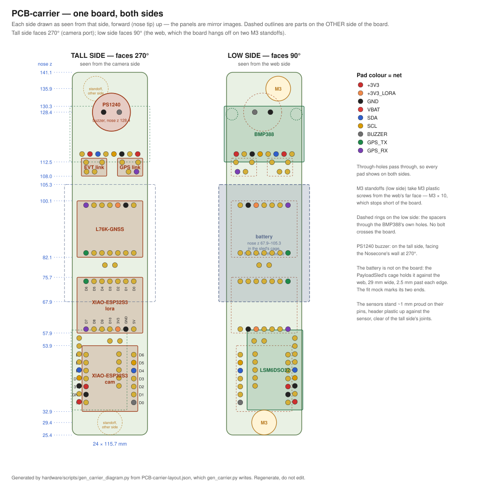

# PCB-carrier — design brief

__Status: adopted, operator 2026-09-11.__ This is the design record for the carrier; [PCB-carrier.md](PCB-carrier.md) is what the generated board is. It replaces the "two identical boards" layout, which was never the operator's decision and was recorded as one in error.

## What the operator asked for

- __One board__ — one physical PCB-carrier, not two
- __Both XIAO stacks on the same side of the board__, one at each end — the tall parts together
- __The web offset between the discs__, out of the board's way
- __Two screws__, for precise alignment, and the board __removable from the sled__ as one unit
- __The camera mounts on the bridge__
- __The GNSS antenna mounts on the ElectronicsSled__

## The design

__One two-sided board on the sled's centre line.__ The __tall side__ faces 270°, the camera port: XIAO-ESP32S3-cam aft, under the camera; XIAO-ESP32S3-lora and the L76K-GNSS, both turned across the board; the two data-link jumpers; the PS1240 buzzer at the forward end. The __low side__ faces 90°, the web: the LSM6DSO32 and BMP388, and two standoffs. The web is moved toward 90°, clear of the low side, and the board hangs off it. Take out two screws and the whole board comes off the sled.

__Every number — size, stations, clearances, the battery's position — is in [PCB-carrier.md](PCB-carrier.md), the carrier's one source of truth.__ This page is the discussion: why each choice was made, and what is decided but not yet drawn. Where the two disagree, PCB-carrier.md wins.

### What makes it work

__1. Every part sits in its own holes, and no hole meets another across the two sides.__ The L76K-GNSS already has its pins soldered, so it takes its own footprint on the tall side, turned like XIAO-ESP32S3-lora ([below](#the-lora-xiao-beside-the-cam-xiao-the-l76k-gnss-turned--decided-2026-10-1516)). The LSM6DSO32 runs __lengthwise__ on the low side, parallel to the rows of XIAO-ESP32S3-cam above it. Turned 90°, its rows would cross theirs. The BMP388 sits behind no module, so it is turned, which frees the tall side's forward end for the buzzer ([#36](https://github.com/jwilleke/js-rocket-avionics/issues/36); [below](#the-buzzer-on-the-board-the-bmp388-turned--decided-2026-10-12)). The LSM6DSO32 is slid sideways to clear XIAO-ESP32S3-cam's real rows ([#33](https://github.com/jwilleke/js-rocket-avionics/issues/33); where, in [PCB-carrier.md](PCB-carrier.md#low-side--faces-90-the-web)). `gen_carrier.py` checks every through-hole against every other on each run.

__2. The sensors stand ~1 mm proud on their pins__, header plastic up against the sensor, so the plastic clears the tall side's solder joints on the low face.

__3. The standoffs are soldered to the board and the screws come in from the web side.__ Würth WA-SMSI M3 standoffs, 10 mm, on the low side; two M3 plastic screws, M3 × 10, through the web into them. Nothing fastens through to the tall side, so __no screw head is ever under a module__. Neither standoff is under a module either: each has a 4.4 mm hole through the board, so standoff 1 sits at the aft end, under the USB-C plug room, clear of XIAO-ESP32S3-cam and the BAT pigtail beneath it (operator, 2026-09-11).

__4. The board does not touch the web.__ It hangs 10 mm off it, so there are no printed pads, no filed tails and no slots.

## Across the bore

The table is in [PCB-carrier.md](PCB-carrier.md#across-the-bore). __Why the board grew toward 270° at 1.6 mm:__ its low face has to stay at r 0.5, where the standoffs put it against the web, so the extra 0.6 mm (1.0 until 2026-09-15) went toward 270° and took the tall side with it. That cost the camera pad 0.6 mm: 2.3 mm over the cam stack, where [#89](https://github.com/jwilleke/js-rocket/issues/89) was designed with 2.9.

__The bridge__ was to stand its fins beside the board's edges and carry the camera pad over the cam stack. __It is left out of the ElectronicsSled fit article__ (2026-09-15): the pad sits in the carrier's path as the carrier goes onto its standoffs from the 270° side. How the camera is held is open.

## Electrically

__One regulator per load.__ XIAO-ESP32S3-cam feeds the +3V3 plane and the sensors; XIAO-ESP32S3-lora feeds only the L76K-GNSS, on its own net, off the plane. __No battery on the board__ (operator, 2026-10-11, [#30](https://github.com/jwilleke/js-rocket-avionics/issues/30)): a Y-cable joins the battery to both XIAOs' BAT pigtails, and the battery's lead runs aft to below the sled, where it unplugs for the charger. The pigtail holes are anchors only. The connection table is in the [README](../../README.md#connections).

### Charging — off the carrier, at the battery's plug below the sled

__Decided, operator 2026-10-10 ([#30](https://github.com/jwilleke/js-rocket-avionics/issues/30)).__ The carrier has no charging parts. The battery is unplugged below the sled, through the nosecone adapter, and charged on its own charger — [LiPo-charger.md](../LiPo-charger/LiPo-charger.md).

- __Why not XIAO-ESP32S3-cam's built-in charger:__ at ~115 mA it loses to XIAO-ESP32S3-lora's draw, and the battery fell 3.5 → 3.4 V in 1 h 25 min of "charging" ([#8](https://github.com/jwilleke/js-rocket-avionics/issues/8))
- __Why not a charger chip on the carrier:__ the chip is a SOT-23-5, a fine-pitch hand-soldering job the operator is not confident doing. The design had assumed it could be done by hand without asking. A ready-made charger needs no soldering at all
- __Why the battery's plug:__ it is already reached below the sled without pulling it, so charging there costs no access. With the battery off both XIAOs, nothing else draws while it charges: the whole 0.5 A goes in, and the charger's light goes out when it is full

### The XIAO pigtails go through holes behind each XIAO — decided, in the generator

__Operator, 2026-09-13 ([#14](https://github.com/jwilleke/js-rocket-avionics/issues/14)).__ Each XIAO's battery pigtail — soldered to its underside BAT pads before it goes onto its headers, ~10 mm long, leaving at the end away from the USB-C — __goes through two holes directly behind that XIAO__, with the holes labelled. The XIAO pads, a miserable job, are never re-soldered. __From 2026-10-11 the holes are anchors only__ (operator, [#30](https://github.com/jwilleke/js-rocket-avionics/issues/30)): the pigtail laces through them and keeps its plug, which mates with the Y-cable. They carry no net, and nothing is soldered there.

__The holes are already in the generator__ (`WIRE_PADS`, `TestPoint_THTPad_D2.0mm_Drill1.0mm`), just past each XIAO's forward end:

| | XIAO's forward end | Holes |
|---|---|---|
| XIAO-ESP32S3-cam | y 28.5 | `TP_CAM_BAT_P` (8.8, 30.0), `TP_CAM_BAT_N` (12.0, 30.0) |
| XIAO-ESP32S3-lora | y 50.3 | `TP_LORA_BAT_P` (10.4, 54.2), `TP_LORA_BAT_N` (13.6, 54.2) |

- __Labelled on both sides__ — `BAT`, `+` and `-` at each pair, mirrored on the low side so it reads from there (`BAT_LABELS` in `gen_carrier.py`, 2026-09-13; DRC 0 violations). Each module's name is also on the board under it, on its own side — `XIAO-ESP32S3 / cam`, `L76K-GNSS`, `XIAO-ESP32S3 / lora` on the tall side, `LSM6DSO32` and `BMP388` mirrored on the low side (`MODULE_LABELS`) — so the carrier says what goes where during assembly
- __Assembly order — the LSM6DSO32 sits over XIAO-ESP32S3-cam's holes on the low side__, ~1 mm off the carrier, so that pigtail is soldered __before the sensor goes on__ and its joints trimmed flush. XIAO-ESP32S3-lora's holes lie under the battery, which is 5.25 mm off the board in the sled's cage
- __Polarity__ is fixed by the holes, not a connector: `+` to `+`, checked with a meter before first power-up
- __Superseded:__ JST sockets on the board for the pigtails (decided and dropped the same day — no room within the pigtail's ~10 mm)

### Two data links, each behind an open jumper — in the generator, pins owed

__Operator, 2026-09-12 ([#26](https://github.com/jwilleke/js-rocket-avionics/issues/26)).__ Both are nice-to-have, so the copper is built now and the features are chosen later. Each link runs through a __standard 2-pin 2.54 mm header with a slide-on shunt__: shunt off, the boards are exactly as isolated as without the link; shunt on, the feature is available to firmware.

| Link | Direction | Gives, with the shunt on | In series |
|---|---|---|---|
| __GPS → mj-cam__ | the L76K's transmit line (`GPS_RX`, into lora `D7`) also to a spare XIAO-ESP32S3-cam input — __listen only__ | the GPS track, ~1 Hz with GPS altitude, in the flight log beside the barometer and IMU | ~1 kΩ at mj-cam's pin, so a firmware mistake there cannot pull the beacon's GPS line down |
| __mj-cam → lora__ | a spare XIAO-ESP32S3-cam output to a spare XIAO-ESP32S3-lora input, for Meshtastic's Serial module — __one way__ | event messages on the private channel — armed, launch, apogee, landed-here — a few per flight, rate-limited in mj-cam | ~1 kΩ, so neither side can drive the other hard |

- __Off is the safe state__, and the one a shaken-loose shunt fails to: a shunt lost under boost costs the feature, never the beacon. Dab it in place if a flight must have the feature
- __Height:__ header plus shunt stands ~8–9 mm, so both go on the __tall side__, where the XIAO stacks already reach 10.7–11.8 mm
- __Where:__ one at each long edge, just forward of the L76K-GNSS, so the buzzer has the middle of the forward end ([#36](https://github.com/jwilleke/js-rocket-avionics/issues/36)). Positions: [PCB-carrier.md](PCB-carrier.md#tall-side--faces-270-the-camera)
- __Set before the nose is closed__ — the shunts are not reachable after
- __Owed before they are drawn:__ which spare pins — mj-cam's `D1` (GPIO2) is the clean choice for the GPS input, `D2` is a strapping pin; the lora side is whatever Meshtastic's `seeed-xiao-s3` variant leaves free beside the Wio-SX1262 — and a bench check that the Serial module does what is described on firmware `2.7.26` ([#26](https://github.com/jwilleke/js-rocket-avionics/issues/26))

## The buzzer on the board, the BMP388 turned — decided 2026-10-12

__Operator, 2026-10-12 ([#36](https://github.com/jwilleke/js-rocket-avionics/issues/36)).__ The PS1240 is on the carrier, at the tall side's forward end, facing the Nosecone's wall at 270°, the camera side. The sound hole in that wall is deferred to a later flight (2026-10-13, [js-rocket#118](https://github.com/jwilleke/js-rocket/issues/118)); the position stands without it. Its two leads go into their own holes; the wire pads that took flying leads to the nose wall are gone. [PS1240-buzzer.md](../PS1240-buzzer/PS1240-buzzer.md) owns the part, [PCB-carrier.md](PCB-carrier.md#layout) where it sits.

__Two things moved to make room, and nothing else did.__ XIAO-ESP32S3-cam, the L76K-GNSS and XIAO-ESP32S3-lora stay where they were.

- __The BMP388 turned 90°__ on the low side, its pin row across the board, aft, and its mounting holes forward at the board's edges. It now rests on a spacer in each of its own holes, with __no bolt and no carrier hole__, so nothing crosses to the tall side — [BMP388-barometer.md](../BMP388-barometer/BMP388-barometer.md#mounting)
- __The two data links went to the board's edges__ ([above](#two-data-links-each-behind-an-open-jumper--in-the-generator-pins-owed))

__Rejected:__

- __Turning the L76K-GNSS__ — it fits, but it moves XIAO-ESP32S3-lora 5.4 mm forward, which its LoRa antenna cable may not reach
- __Swapping the L76K-GNSS and XIAO-ESP32S3-lora__ — the GNSS would land on the BMP388

Both were taken up on 2026-10-15/16, together — [below](#the-lora-xiao-beside-the-cam-xiao-the-l76k-gnss-turned--decided-2026-10-1516).

__Checked in the generator, 2026-10-12:__ `verify_clearances()` passes (78 through-holes clear of each other, the standoffs, the BMP388's spacers and the buzzer); kicad-cli DRC 0 violations, 11 unconnected items — the unrouted nets, unchanged. The fit mock was regenerated and re-sliced, and all 84 holes and markers are open in the G-code; the plate is js-rocket's `rocket/printing/ready/carrier-fit-mock.gcode.3mf`.

## The lora XIAO beside the cam XIAO, the L76K-GNSS turned — decided 2026-10-15/16

__Operator, 2026-10-15/16 ([#36](https://github.com/jwilleke/js-rocket-avionics/issues/36)).__ XIAO-ESP32S3-lora moves aft to sit right after XIAO-ESP32S3-cam, still turned 90°, USB-C out the board's -x long edge. The L76K-GNSS is __turned 90°__ too, its header rows across the board, and sits forward of the lora XIAO's anchor holes, its antenna end toward the board's +x long edge, away from the -x edge the LoRa lead runs round. Positions: [PCB-carrier.md](PCB-carrier.md#tall-side--faces-270-the-camera).

__Why.__ The LoRa strip's ~82 mm lead was too short: it is what set the strip's tilt at the PORT end ([Antennas.md](../Antennas/Antennas.md#where-the-lora-strip-goes)). The move puts the lora XIAO about 27 mm nearer that end. The L76K-GNSS, forward of it, ends up about 22 mm nearer its patch on the sled's forward disc. Both leads get shorter runs.

__Why the 2026-10-12 rejections no longer hold.__ Turning the L76K-GNSS was rejected because it pushed XIAO-ESP32S3-lora forward, away from its strip; here the lora XIAO goes aft instead, ahead of the GNSS, so that objection is gone. The swap was rejected because the GNSS would land on the BMP388. The BMP388 has since been turned and sits forward, under the buzzer, and the turned GNSS takes 18 mm of board length instead of 21, so it now fits between the lora XIAO's anchor holes and the data links.

__Nothing else moved:__ XIAO-ESP32S3-cam, the LSM6DSO32, the BMP388 on its spacers, the data links and the buzzer stay where they were.

__Checked in the generator, 2026-10-16:__ `verify_pins()` passes, and holds the turned L76K-GNSS to a second route, Seeed's drawing turned by eye; `verify_clearances()` passes (78 through-holes clear); kicad-cli DRC 0 violations, 11 unconnected items — the unrouted nets, unchanged. The fit mock was regenerated and re-sliced, and all 84 holes and markers are open in the G-code; the plate is js-rocket's `rocket/printing/ready/carrier-fit-mock.gcode.3mf`, about 16 minutes.

__Open, not decided:__ the LoRa lead now has slack, so the strip's position and tilt could be revisited ([Antennas.md](../Antennas/Antennas.md#where-the-lora-strip-goes)).

## The battery sits behind the carrier — decided 2026-09-14, layout B2 2026-09-15

__Operator: behind the carrier on 2026-09-14, layout B2 on 2026-09-15.__ The battery lies behind the carrier's __low face__, between the board and the moved web, long axis along the sled, 29 mm across (2.5 mm past each board edge). __Its position is in [PCB-carrier.md](PCB-carrier.md#low-side--faces-90-the-web)__, which owns it.

__It moved once more on 2026-09-15.__ B2 first drew it on a 1 mm insulating pad against the board. It was then set __against the web__ instead, in a cage, and 1.2 mm further aft so the cage's forward wall clears the BMP388. [PCB-carrier.md](PCB-carrier.md#low-side--faces-90-the-web) records the position; the ElectronicsSled's cage ([js-rocket#99](https://github.com/jwilleke/js-rocket/issues/99)) is built to it.

__Why behind the board.__ It is the only place beside the carrier that passes the 40 mm door ([Across the bore](PCB-carrier.md#across-the-bore)). Everywhere else beside the board a 29 mm battery reaches r 22–23. The old spot — on the sled's D-flat at nose z 125–161 — put its forward corners __~1.2 mm into the Nosecone wall__, read off `nosecone.stl` on 2026-09-13 ([js-rocket#99](https://github.com/jwilleke/js-rocket/issues/99#issuecomment-5654142688)).

__Why B2, and not the first drawing.__ The first drawing (2026-09-14) put the battery at nose z 101–137 with both sensors slid 20 mm aft. `gen_carrier.py`'s clearance check rejected it: the BMP388's two M2 legs, 20.6 mm apart ([its 2026-09-11 mounting](../BMP388-barometer/BMP388-barometer.md)), landed on the L76K-GNSS's header joints. Both legs had to fall in the gaps between the tall side's header rows and clear the JST, which left the BMP388 very few places (it has had no legs since 2026-10-12: [above](#the-buzzer-on-the-board-the-bmp388-turned--decided-2026-10-12)). B2 moves the LSM6DSO32 aft and the BMP388 forward, and the battery takes the low side between them. The other way — the BMP388 on its header alone, keeping the battery at 101–137 — was offered and not chosen.

__Layout B2 — in the generator, 2026-09-15.__ `verify_clearances()` passed (72 through-holes clear of each other, the standoffs and the BMP388 legs); kicad-cli DRC 0 violations, 10 unconnected items — the unrouted nets, as before. B2 lengthened the board from 90.4 mm, moved the LSM6DSO32 aft and the BMP388 and the forward standoff forward, and put the battery on the low side between the sensors. __Where everything now is: [PCB-carrier.md](PCB-carrier.md#layout).__

__Owed before the carrier is ordered:__

1. __Stability.__ The battery's centre is now __~56 mm aft__ of the old D-flat spot, and aft mass is expensive ([configurations.md](https://github.com/jwilleke/js-rocket/blob/main/docs/configurations.md#where-the-ballast-goes-and-why-placement-matters)). Re-derive the nose's CG and re-run the flight-3 stability numbers
2. __Stiffness.__ The standoffs are further apart than the 81 mm the board was first judged at. The battery no longer loads the span: it rides the sled, in its cage. The board is __1.6 mm__ since 2026-09-15 — OSH Park's only 4-layer thickness — about 4× as stiff as the 1.0 mm it was judged at. Still check it; the fit mock is a first look, not an answer
3. __Retention.__ The sled's cage holds it: three-sided, taped on its open sides ([js-rocket#99](https://github.com/jwilleke/js-rocket/issues/99)). __Never clamp the pouch__
4. __The joints under the battery__ — the L76K-GNSS's header joints, XIAO-ESP32S3-lora's forward header row and XIAO-ESP32S3-lora's BAT pigtail at its anchor holes — face 5.25 mm of air, not the pouch. Trim them flush anyway
5. __The battery lead__ leaves the battery's aft end and runs to below the sled, to the Y-cable
6. __The GNSS patch__ sits in a pocket in the sled's forward disc, off the carrier ([js-rocket#99](https://github.com/jwilleke/js-rocket/issues/99))

Drawing: [`nose-assembly-6e81cfc.html`](https://github.com/jwilleke/js-rocket/blob/main/docs/designs/nose-assembly-6e81cfc.html) — it draws the one carrier in PCB-carrier.md.

## What changes in the sled — js-rocket#99

__Built 2026-09-15 as the ElectronicsSled fit article__ ([js-rocket#99](https://github.com/jwilleke/js-rocket/issues/99), js-rocket `6d7ba00`). The web moves to r 10.5–13.5 toward 90°. The two M3 holes are printed at the standoffs, not drilled. It adds the battery cage, a ballast cup, and a 2 mm GNSS patch pocket in the forward disc. There are no pads, no slots and no board-to-web contact. __Left out: #89's camera pad__, which blocks the carrier going on. The sled's own page owns its numbers: [payload-sled.md](https://github.com/jwilleke/js-rocket/blob/main/docs/3d-printed-parts/payload-sled.md).

## Checks owed before building

1. __The standoff part__: Würth WA-SMSI M3, 10 mm (9774100360) — confirm it is stocked
2. ~~__The buzzer's lead pitch__~~ — done 2026-10-15: 5.0 mm on the part in hand, matching the carrier's holes ([#36](https://github.com/jwilleke/js-rocket-avionics/issues/36))

Settled by the generator rather than owed: every sensor's pin order on the back of the board, and every hole's clearance across the two sides.

__Settled on the bench, 2026-09-11:__ stock Meshtastic reads the GPS on D6/D7 — its startup log names GPIO43/44 and detects the L76K ([#6](https://github.com/jwilleke/js-rocket-avionics/issues/6#issuecomment-5639176943)). So the carrier's `GPS_TX`/`GPS_RX` nets stand as drawn.

## How it got here

The first layout, one board with parts on both faces, was derived from a camera-port drawing that put the board and the sled's web in the same place. When that surfaced ([#13](https://github.com/jwilleke/js-rocket-avionics/issues/13)), the session wrongly turned the operator's "prefer one board" into two identical boards, one on each web face, and built on it. This design goes back to what was asked for: one board, the web moved out of its way, both stacks on one side.
